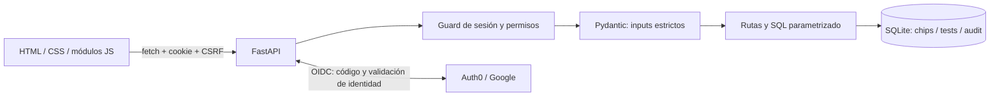
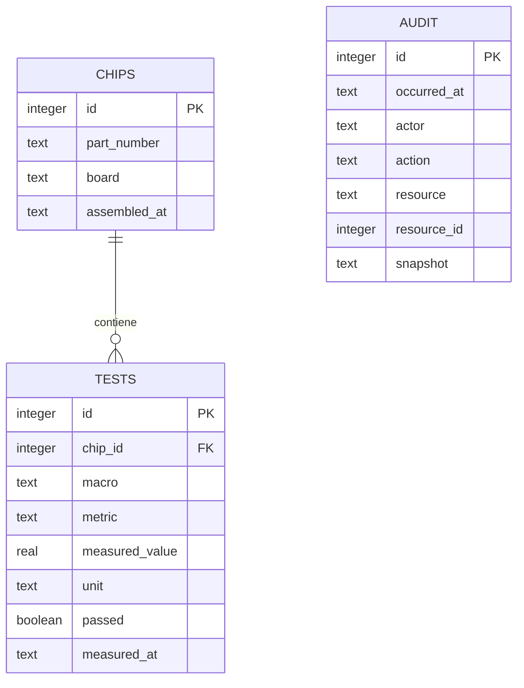

# Arquitectura y decisiones

## Componentes

`create_app(settings)` permite instanciar la aplicación con configuración y base
propias en pruebas. `lifespan` crea el esquema antes de aceptar pedidos.
`run.py` arranca un proceso en loopback; no activa recarga automática.

## Modelo relacional

`audit` no tiene FK al recurso: debe sobrevivir a su eliminación. Los borrados de
chip conservan una copia de sus ensayos. La auditoría tiene paginación por cursor,
pero no retención automática ni protección frente a quien puede editar el archivo
SQLite. Es trazabilidad operativa, no un registro criptográficamente inmutable.

## Decisiones y alternativas

| Decisión | Motivo | Costo / alternativa |
|---|---|---|
| Un proceso y mismo origen | Simplifica instalación y evita CORS | Separar servicios si crece el despliegue |
| SQLite con SQL parametrizado | Hace visibles relaciones y transacciones, sin un servidor adicional | PostgreSQL para más escritores concurrentes |
| `sqlite3` en vez de ORM del ejemplo | Esquema pequeño y cascada explícita | Migraciones futuras deben escribirse y probarse |
| JavaScript nativo sin build | El alumno puede seguir eventos y requests directamente | Framework si crece el estado compartido |
| Paths originales sin `/api` | Compatibilidad con el contrato del alumno | Frontend en `/`, estáticos en `/assets` |
| Enum Tx/Rx/PLL | Arquitectura fija del chip | No permite modelos de chip con macros distintas |
| `part_number` no único | Varias muestras del mismo diseño | ID identifica la muestra; falta serial físico si se necesita |
| Error 400 en validación | Lo exige el contrato | Se adapta el 422 predeterminado de FastAPI |
| Campos extra prohibidos | Evita IDs suministrados por el cliente y contradicción con path | Endurecimiento compatible con clientes válidos del TP2 |
| UTC para ensayos | Evita interpretar timestamps de Argentina como UTC | La fecha de ensamblado sigue siendo una fecha sin hora |
| `BEGIN IMMEDIATE` en lectura + escritura | Evita carreras entre verificar existencia y borrar/crear | SQLite serializa escritores y espera hasta 10 s |
| Auditoría en misma transacción | No puede haber escritura exitosa sin su evidencia | Un fallo de auditoría bloquea la escritura |
| Auth0 mediante servidor | Los tokens OAuth no se guardan en el navegador | Requiere configurar tenant, callback y secreto |
| Permisos por `sub` | Identidad estable; no confiar en nombres o emails | Lista de operadores requiere reiniciar al cambiar configuración |
| Cookie firmada, no cifrada | Integración simple con Authlib | Guardar solo subject, nombre y CSRF; no secretos |
| CSV en navegador | Exporta exactamente lo visible, sin endpoint duplicado | No exporta el laboratorio completo; neutraliza fórmulas de texto |

## Flujo de escritura

1. `/session` entrega identidad, permisos y CSRF asociado a la cookie.
2. `api.js` envía JSON y `X-CSRF-Token` en POST/DELETE.
3. El guard comprueba sesión, CSRF y permiso de operador antes del endpoint.
4. Pydantic valida campos y formatos; el path fija chip y macro.
5. La ruta usa parámetros SQL, comprueba jerarquía y modifica la base.
6. Inserta auditoría con subject del usuario. Commit antes de devolver 201/204.
7. La UI refresca inventario, métricas y ensayos. Un fallo de refresco posterior
   a una creación confirmada avisa “Guardado confirmado” para evitar duplicados.

Cada carga de ensayos lleva un contador de revisión: si el usuario cambia de chip
o macro antes de recibir la respuesta, la respuesta vieja se descarta. Los textos
externos se insertan con `textContent`; no se interpretan como HTML.

## Contrato y compatibilidad

La versión 1.1.0 conserva las seis operaciones, sus operationIds y schemas de
salida del TP2. Documenta restricciones nuevas de longitud, IDs positivos, campos
extra y errores de seguridad. POST sigue siendo no idempotente; dos altas válidas
crean dos registros. DELETE es idempotente respecto del estado final, aunque una
repetición devuelva 404. Los opcionales ausentes se omiten, no se devuelven como null.

Los arrays originales no se envolvieron en un objeto para introducir paginación.
La evolución a paginación completa debe versionarse, según el roadmap.

## Referencias técnicas consultadas

- [Pruebas FastAPI](https://fastapi.tiangolo.com/tutorial/testing/): TestClient.
- [Lifespan FastAPI](https://fastapi.tiangolo.com/advanced/events/): arranque y recursos.
- [Cliente Starlette de Authlib](https://docs.authlib.org/en/v1.6.9/client/starlette.html):
  flujo authorize_redirect / authorize_access_token; además se inspeccionó el código
  de la versión instalada 1.8.0 para excepciones de validación de tokens.

No se agregan dependencias de IA en tiempo de ejecución: el objeto del curso es
dirigir la construcción del producto con IA, no inventar una función generativa.
